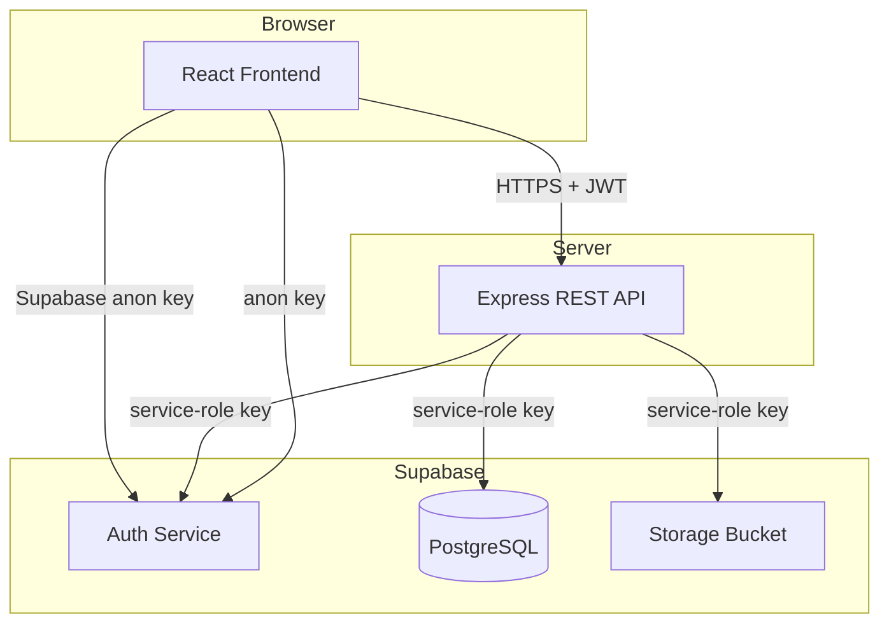
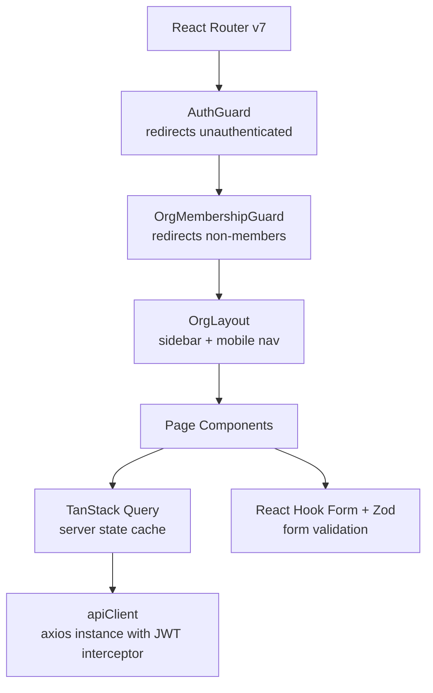
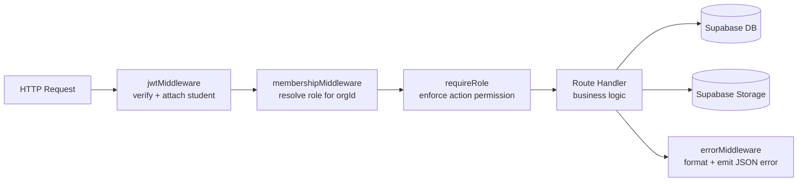
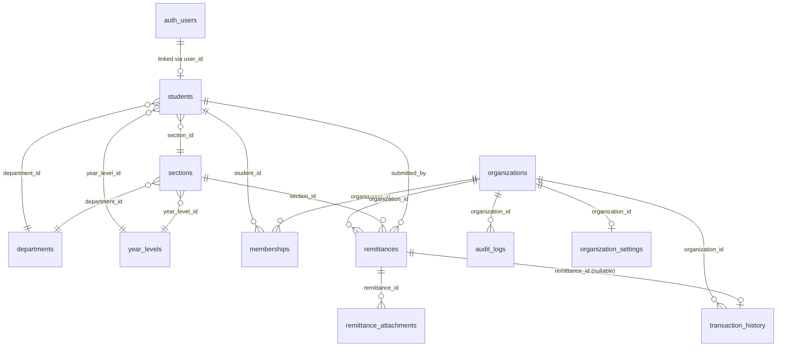

# Design Document

## Overview

The Org Budget Tracker is a multi-tenant web platform for student organizations to manage remittance collections, budget visibility, and financial reporting. A signed-in student may belong to several organizations simultaneously, holding a different role in each. The platform enforces role-based access at both the API and UI layers, maintains an append-only financial ledger, and provides every member transparent read access to their organization's budget.

The system is composed of four runtime layers:

| Layer | Technology | Responsibility |
|---|---|---|
| Frontend | React 19 (Vite), React Router v7, TanStack Query, React Hook Form, Zod | UI rendering, route guards, form validation, data fetching |
| API | Express.js (Node ESM), Zod, Supabase JS SDK (service role) | Auth verification, role-based authorization, business rules, data access |
| Database | PostgreSQL on Supabase, SQL migrations, RLS | Persistent storage, constraint enforcement, row-level security |
| Auth & Storage | Supabase Auth (email/password), Supabase Storage (private bucket) | JWT issuance, session management, file storage, signed URL generation |

The figma-make prototype (`figma-make/src/App.tsx`) is the canonical UX and visual reference. All screen layouts, navigation hierarchy, component arrangement, and responsive breakpoints must match the prototype.

---

## Architecture

### High-Level Request Flow

```mermaid
sequenceDiagram
    participant U as Student (Browser)
    participant FE as Frontend (React)
    participant API as Express API
    participant DB as Supabase DB
    participant Auth as Supabase Auth
    participant Store as Supabase Storage

    U->>FE: Interact with UI
    FE->>Auth: Sign in (email/password)
    Auth-->>FE: JWT + session
    FE->>API: HTTP request + Authorization: Bearer <JWT>
    API->>Auth: Verify JWT
    Auth-->>API: Decoded claims (user ID)
    API->>DB: Query with service-role client
    DB-->>API: Result rows
    API-->>FE: JSON response
    FE->>U: Render updated UI
    
    Note over FE,Store: File uploads go directly to Storage; API returns signed URLs for downloads
```

### System Context



### Organization-Scoped Routing

All organization resources are mounted under `/orgs/:orgId/`. The API's `requireMembership` middleware resolves the requesting student's active membership for that `orgId` and injects the role into `req.membership` before any route handler runs. Route handlers then use `requireRole(...)` to enforce action-level permissions.

```
/auth/signup
/auth/login
/orgs                        ← My Organizations list
/orgs/:orgId/dashboard
/orgs/:orgId/remittances
/orgs/:orgId/remittances/:remittanceId
/orgs/:orgId/members
/orgs/:orgId/history
/orgs/:orgId/reports
/orgs/:orgId/audit
/orgs/:orgId/settings
```

### Frontend Architecture



### Backend Architecture



---

## Components and Interfaces

### Frontend Components

#### Route Guards

**`AuthGuard`** — Wraps all protected routes. Reads the Supabase Auth session from context. If no session, redirects to `/login`. Renders nothing (no role-restricted controls) while session is loading.

**`OrgMembershipGuard`** — Wraps all `/orgs/:orgId/*` routes. Fetches the student's active membership for the current `orgId`. If no active membership, redirects to `/orgs`. Renders a loading state while fetching.

#### Layout Components

**`OrgLayout`** — Contains:
- **Desktop (≥ 1024 px)**: Left sidebar with organization switcher (`OrgSwitch`) and nav links (Dashboard, Remittances, Members, History, Reports, Audit, Settings).
- **Mobile (< 768 px)**: Bottom navigation bar with the same links shown as icon+label tabs.
- **Tablet (768–1023 px)**: Consistent primary navigation (bottom bar or sidebar) across all primary destinations.

The layout receives the current user's role from context and passes it to child pages so each page can conditionally render action controls.

#### Page Components

| Page | Route | Key behavior |
|---|---|---|
| `SignUpPage` | `/signup` | React Hook Form + Zod; calls Supabase Auth then POST `/api/students/profile` |
| `LoginPage` | `/login` | Supabase Auth signInWithPassword; stores session |
| `MyOrgsPage` | `/orgs` | Lists active memberships; empty state; "Register Another Org" button |
| `RegisterOrgPage` | `/orgs/new` | Form for org name, description, department |
| `DashboardPage` | `/orgs/:orgId/dashboard` | Budget card, stats, budget-over-time chart, recent activity |
| `RemittancesPage` | `/orgs/:orgId/remittances` | Tabbed filter (all/pending/confirmed/rejected); table/card list; "Log a remittance" for class_rep |
| `RemittanceFormPage` | `/orgs/:orgId/remittances/new` | Log remittance form with file upload preview |
| `RemittanceDetailPage` | `/orgs/:orgId/remittances/:id` | Summary, proof viewer, status timeline, review panel (Org Member/Class Treasurer) |
| `MembersPage` | `/orgs/:orgId/members` | Full list (org_member) or section-filtered list (class_rep); member side-panel |
| `HistoryPage` | `/orgs/:orgId/history` | Paginated, sortable, filterable ledger; read-only |
| `ReportsPage` | `/orgs/:orgId/reports` | Remittances-per-section chart, monthly totals, budget over time; date filter; CSV export |
| `AuditPage` | `/orgs/:orgId/audit` | Read-only audit log; visible to org_member and class_treasurer only |
| `SettingsPage` | `/orgs/:orgId/settings` | Editable for org_member; read-only for all others |

#### Shared UI Patterns

- **`LoadingState`** — Skeleton rows/cards shown while any TanStack Query fetch is `isLoading`.
- **`EmptyState`** — Centered icon + message + optional CTA when a list returns zero items.
- **`ErrorState`** — Error message + "Try again" retry button when a fetch fails.
- **`ConfirmationDialog`** — AlertDialog shown before destructive actions (confirm/reject remittance).
- **`MoneyDisplay`** — Formats numbers as `₱X,XXX.XX` using `Intl.NumberFormat` with `en-PH` locale and `PHP` currency.

### API Routes and Middleware

#### Middleware Stack (applied in order)

```
corsMiddleware          → allow requests from frontend origin
expressJson             → parse application/json body
jwtMiddleware           → verify Supabase JWT; attach req.studentId
membershipMiddleware    → resolve active Membership for :orgId; attach req.membership
requireRole(roles[])    → check req.membership.role ∈ roles; 403 if not
errorMiddleware         → catch-all; format unified JSON error response
```

#### Auth Routes (`/api/auth`)

| Method | Path | Auth | Description |
|---|---|---|---|
| POST | `/api/auth/signup` | Public | Create auth user + student profile atomically |
| POST | `/api/auth/login` | Public | Sign in via Supabase Auth (handled client-side; endpoint for profile fetch on first login) |

#### Student Routes (`/api/students`)

| Method | Path | Auth | Description |
|---|---|---|---|
| GET | `/api/students/me` | JWT | Get current student's profile |

#### Organization Routes (`/api/orgs`)

| Method | Path | Auth | Roles | Description |
|---|---|---|---|---|
| GET | `/api/orgs` | JWT | — | List active memberships for current student |
| POST | `/api/orgs` | JWT | — | Register new organization; create org_member membership |
| GET | `/api/orgs/:orgId` | JWT + member | all | Get org details |

#### Membership Routes (`/api/orgs/:orgId/members`)

| Method | Path | Auth | Roles | Description |
|---|---|---|---|---|
| GET | `/api/orgs/:orgId/members` | JWT + member | all | List members (org_member: all; class_rep: own section) |
| GET | `/api/orgs/:orgId/members/:memberId` | JWT + member | all | Get member detail |
| PATCH | `/api/orgs/:orgId/members/:memberId` | JWT + member | org_member | Update member role/section; write audit log |

#### Remittance Routes (`/api/orgs/:orgId/remittances`)

| Method | Path | Auth | Roles | Description |
|---|---|---|---|---|
| GET | `/api/orgs/:orgId/remittances` | JWT + member | all | List remittances (filtered by role) |
| POST | `/api/orgs/:orgId/remittances` | JWT + member | class_rep | Create remittance + attachments; write audit log |
| GET | `/api/orgs/:orgId/remittances/:id` | JWT + member | all | Get remittance detail |
| POST | `/api/orgs/:orgId/remittances/:id/confirm` | JWT + member | org_member, class_treasurer | Confirm; atomic transaction insert + audit log |
| POST | `/api/orgs/:orgId/remittances/:id/reject` | JWT + member | org_member, class_treasurer | Reject; write audit log |
| GET | `/api/orgs/:orgId/remittances/:id/attachments/:attachId/url` | JWT + member | all | Return signed URL (1 hour) |

#### Transaction History Routes (`/api/orgs/:orgId/history`)

| Method | Path | Auth | Roles | Description |
|---|---|---|---|---|
| GET | `/api/orgs/:orgId/history` | JWT + member | all | Paginated ledger (max 50/page); filters: type, date range ≤ 365 days |

#### Reports Routes (`/api/orgs/:orgId/reports`)

| Method | Path | Auth | Roles | Description |
|---|---|---|---|---|
| GET | `/api/orgs/:orgId/reports/sections` | JWT + member | all | Remittances per section; date range ≤ 24 months |
| GET | `/api/orgs/:orgId/reports/monthly` | JWT + member | all | Monthly totals; date range ≤ 24 months |
| GET | `/api/orgs/:orgId/reports/budget-over-time` | JWT + member | all | Budget over time; date range ≤ 24 months |
| GET | `/api/orgs/:orgId/reports/export` | JWT + member | all | CSV download of active report view |

#### Audit Routes (`/api/orgs/:orgId/audit`)

| Method | Path | Auth | Roles | Description |
|---|---|---|---|---|
| GET | `/api/orgs/:orgId/audit` | JWT + member | org_member, class_treasurer | Paginated audit log |

#### Settings Routes (`/api/orgs/:orgId/settings`)

| Method | Path | Auth | Roles | Description |
|---|---|---|---|---|
| GET | `/api/orgs/:orgId/settings` | JWT + member | all | Get current settings |
| PUT | `/api/orgs/:orgId/settings` | JWT + member | org_member | Save settings; write audit log |

---

## Data Models

### Database Schema



### Table Definitions

#### `departments`
```sql
CREATE TABLE departments (
  id          uuid PRIMARY KEY DEFAULT gen_random_uuid(),
  name        text NOT NULL UNIQUE,
  created_at  timestamptz NOT NULL DEFAULT now()
);
```

#### `year_levels`
```sql
CREATE TABLE year_levels (
  id          uuid PRIMARY KEY DEFAULT gen_random_uuid(),
  name        text NOT NULL UNIQUE,  -- e.g. "1st Year"
  sort_order  int  NOT NULL,
  created_at  timestamptz NOT NULL DEFAULT now()
);
```

#### `sections`
```sql
CREATE TABLE sections (
  id              uuid PRIMARY KEY DEFAULT gen_random_uuid(),
  name            text NOT NULL,
  department_id   uuid NOT NULL REFERENCES departments(id),
  year_level_id   uuid NOT NULL REFERENCES year_levels(id),
  created_at      timestamptz NOT NULL DEFAULT now(),
  UNIQUE (name, department_id, year_level_id)
);
```

#### `students`
```sql
CREATE TABLE students (
  id              uuid PRIMARY KEY DEFAULT gen_random_uuid(),
  user_id         uuid NOT NULL UNIQUE REFERENCES auth.users(id) ON DELETE CASCADE,
  student_number  text NOT NULL UNIQUE CHECK (char_length(student_number) BETWEEN 1 AND 20),
  full_name       text NOT NULL CHECK (char_length(full_name) BETWEEN 1 AND 100),
  email           text NOT NULL UNIQUE,
  year_level_id   uuid REFERENCES year_levels(id),
  section_id      uuid REFERENCES sections(id),
  department_id   uuid REFERENCES departments(id),
  created_at      timestamptz NOT NULL DEFAULT now()
);
```

#### `organizations`
```sql
CREATE TABLE organizations (
  id            uuid PRIMARY KEY DEFAULT gen_random_uuid(),
  name          text NOT NULL CHECK (char_length(name) BETWEEN 1 AND 100),
  description   text CHECK (char_length(description) <= 500),
  department    text CHECK (char_length(department) <= 100),
  status        text NOT NULL DEFAULT 'active' CHECK (status IN ('active', 'inactive')),
  created_by    uuid NOT NULL REFERENCES students(id),
  created_at    timestamptz NOT NULL DEFAULT now()
);
```

#### `memberships`
```sql
CREATE TABLE memberships (
  id              uuid PRIMARY KEY DEFAULT gen_random_uuid(),
  student_id      uuid NOT NULL REFERENCES students(id),
  organization_id uuid NOT NULL REFERENCES organizations(id),
  role            text NOT NULL CHECK (role IN ('org_member', 'class_rep', 'class_treasurer', 'student')),
  section_id      uuid REFERENCES sections(id),
  status          text NOT NULL DEFAULT 'active' CHECK (status IN ('active', 'inactive')),
  created_at      timestamptz NOT NULL DEFAULT now(),
  UNIQUE (student_id, organization_id, status),  -- one active membership per student per org enforced via partial unique index
  CONSTRAINT section_required_for_section_roles CHECK (
    (role IN ('class_rep', 'class_treasurer') AND section_id IS NOT NULL)
    OR (role IN ('org_member', 'student') AND section_id IS NULL)
  )
);
-- Partial unique index: one active membership per student per org
CREATE UNIQUE INDEX memberships_one_active_per_student_org
  ON memberships (student_id, organization_id)
  WHERE status = 'active';
```

#### `remittances`
```sql
CREATE TABLE remittances (
  id              uuid PRIMARY KEY DEFAULT gen_random_uuid(),
  organization_id uuid NOT NULL REFERENCES organizations(id),
  section_id      uuid NOT NULL REFERENCES sections(id),
  submitted_by    uuid NOT NULL REFERENCES students(id),
  amount          numeric(12,2) NOT NULL CHECK (amount > 0),
  collection_date date NOT NULL,
  notes           text NOT NULL,
  status          text NOT NULL DEFAULT 'pending' CHECK (status IN ('pending', 'confirmed', 'rejected')),
  reviewed_by     uuid REFERENCES students(id),
  reviewed_at     timestamptz,
  rejection_reason text CHECK (char_length(rejection_reason) BETWEEN 1 AND 500),
  created_at      timestamptz NOT NULL DEFAULT now()
);
CREATE INDEX remittances_org_status_idx ON remittances (organization_id, status);
CREATE INDEX remittances_section_idx    ON remittances (section_id);
CREATE INDEX remittances_submitted_by_idx ON remittances (submitted_by);
```

#### `remittance_attachments`
```sql
CREATE TABLE remittance_attachments (
  id              uuid PRIMARY KEY DEFAULT gen_random_uuid(),
  remittance_id   uuid NOT NULL REFERENCES remittances(id),
  storage_path    text NOT NULL,
  file_name       text NOT NULL,
  mime_type       text NOT NULL CHECK (mime_type IN ('image/jpeg','image/png','image/webp','application/pdf')),
  size_bytes      bigint NOT NULL CHECK (size_bytes > 0 AND size_bytes <= 10485760),  -- 10 MB
  created_at      timestamptz NOT NULL DEFAULT now()
);
CREATE INDEX remittance_attachments_remittance_idx ON remittance_attachments (remittance_id);
```

#### `transaction_history`
```sql
CREATE TABLE transaction_history (
  id              uuid PRIMARY KEY DEFAULT gen_random_uuid(),
  organization_id uuid NOT NULL REFERENCES organizations(id),
  type            text NOT NULL CHECK (type IN ('remittance', 'expense', 'adjustment')),
  amount          numeric(12,2) NOT NULL CHECK (amount > 0),
  remittance_id   uuid REFERENCES remittances(id),
  description     text NOT NULL,
  created_by      uuid NOT NULL REFERENCES students(id),
  created_at      timestamptz NOT NULL DEFAULT now()
);
-- RLS / trigger: prevent UPDATE and DELETE on this table (append-only enforcement)
CREATE INDEX transaction_history_org_idx      ON transaction_history (organization_id);
CREATE INDEX transaction_history_created_at   ON transaction_history (organization_id, created_at DESC);
CREATE INDEX transaction_history_type_idx     ON transaction_history (organization_id, type);
```

#### `audit_logs`
```sql
CREATE TABLE audit_logs (
  id              uuid PRIMARY KEY DEFAULT gen_random_uuid(),
  organization_id uuid NOT NULL REFERENCES organizations(id),
  actor_id        uuid NOT NULL REFERENCES students(id),
  action          text NOT NULL,  -- e.g. 'remittance.created', 'remittance.confirmed'
  entity_type     text NOT NULL,  -- e.g. 'remittance', 'membership', 'settings'
  entity_id       uuid,
  before_state    jsonb,
  after_state     jsonb,
  created_at      timestamptz NOT NULL DEFAULT now()
);
CREATE INDEX audit_logs_org_idx ON audit_logs (organization_id, created_at DESC);
```

#### `organization_settings`
```sql
CREATE TABLE organization_settings (
  id                        uuid PRIMARY KEY DEFAULT gen_random_uuid(),
  organization_id           uuid NOT NULL UNIQUE REFERENCES organizations(id),
  remittance_amount_per_member numeric(12,2) NOT NULL
    CHECK (remittance_amount_per_member BETWEEN 0.01 AND 999999.99),
  academic_year             text NOT NULL
    CHECK (academic_year ~ '^\d{4}-\d{4}$'),  -- validated in API as consecutive years
  updated_at                timestamptz NOT NULL DEFAULT now()
);
```

### Zod Schemas (API + Frontend shared validation)

```typescript
// Student signup
const SignupSchema = z.object({
  email: z.string().email(),
  password: z.string().min(8),
  student_number: z.string().min(1).max(20),
  full_name: z.string().min(1).max(100),
  year_level_id: z.string().uuid(),
  section_id: z.string().uuid(),
  department_id: z.string().uuid(),
});

// Organization registration
const RegisterOrgSchema = z.object({
  name: z.string().min(1).max(100),
  description: z.string().max(500).optional(),
  department: z.string().max(100).optional(),
});

// Remittance creation
const CreateRemittanceSchema = z.object({
  amount: z.number().positive(),
  collection_date: z.string().date(),
  notes: z.string().min(1),
  // attachments validated separately via multipart
});

// Remittance rejection
const RejectRemittanceSchema = z.object({
  rejection_reason: z.string().min(1).max(500),
});

// Membership update
const UpdateMembershipSchema = z.object({
  role: z.enum(['org_member', 'class_rep', 'class_treasurer', 'student']),
  section_id: z.string().uuid().optional(),
}).refine(
  data => !['class_rep','class_treasurer'].includes(data.role) || !!data.section_id,
  { message: 'section_id required for class_rep and class_treasurer' }
);

// Organization settings
const academicYearRegex = /^\d{4}-\d{4}$/;
const OrgSettingsSchema = z.object({
  remittance_amount_per_member: z.number().min(0.01).max(999999.99),
  academic_year: z.string().regex(academicYearRegex),
}).refine(data => {
  const [y1, y2] = data.academic_year.split('-').map(Number);
  return y2 === y1 + 1;
}, { message: 'academic_year must be consecutive years (e.g. 2024-2025)' });

// History query params
const HistoryQuerySchema = z.object({
  page: z.coerce.number().int().min(1).default(1),
  page_size: z.coerce.number().int().min(1).max(50).default(20),
  type: z.enum(['remittance','expense','adjustment']).optional(),
  start_date: z.string().date().optional(),
  end_date: z.string().date().optional(),
});
```

### API Response Shapes

#### Success (single resource)
```json
{ "data": { ...resource } }
```

#### Success (list with pagination)
```json
{
  "data": [ ...items ],
  "meta": {
    "page": 1,
    "page_size": 20,
    "total_rows": 143,
    "total_pages": 8
  }
}
```

#### Error (all error types)
```json
{
  "error": {
    "status": 400,
    "message": "Validation failed",
    "fields": { "amount": "Must be greater than zero" }
  }
}
```

### Role Permission Matrix

| Action | org_member | class_rep | class_treasurer | student |
|---|:---:|:---:|:---:|:---:|
| View dashboard, budget, history, reports | ✓ | ✓ | ✓ | ✓ |
| View all remittances | ✓ | own only | ✓ | ✓ (read-only) |
| Log a remittance | ✓ | ✓ (own section) | ✗ | ✗ |
| Confirm/reject remittance | ✓ | ✗ | ✓ | ✗ |
| View all members | ✓ | own section | ✓ | ✓ |
| Update member role | ✓ | ✗ | ✗ | ✗ |
| View audit log | ✓ | ✗ | ✓ | ✗ |
| Edit organization settings | ✓ | ✗ | ✗ | ✗ |

### Budget Computation

The budget is never stored as a column. It is always computed on demand:

```sql
SELECT
  COALESCE(SUM(CASE WHEN type IN ('remittance','adjustment') THEN amount
                    WHEN type = 'expense'                    THEN -amount
               END), 0) AS budget
FROM transaction_history
WHERE organization_id = $1;
```

This query runs server-side and its result is returned as part of the dashboard endpoint. All amounts are `NUMERIC(12,2)`; no floating-point arithmetic is used anywhere in the system.

### Remittance Confirmation Transaction

The confirm action must be atomic. The API executes the following operations inside a single PostgreSQL transaction via the Supabase service-role client using an RPC function:

```sql
-- rpc: confirm_remittance(p_remittance_id, p_reviewer_id)
BEGIN;
  -- 1. Guard: reject if not pending
  IF remittance.status != 'pending' THEN RAISE EXCEPTION 'not_pending'; END IF;
  -- 2. Guard: reject self-review
  IF remittance.submitted_by = p_reviewer_id THEN RAISE EXCEPTION 'self_review'; END IF;
  -- 3. Update remittance status
  UPDATE remittances SET status='confirmed', reviewed_by=p_reviewer_id, reviewed_at=now()
    WHERE id = p_remittance_id;
  -- 4. Insert ledger row
  INSERT INTO transaction_history (organization_id, type, amount, remittance_id, description, created_by)
    VALUES (remittance.organization_id, 'remittance', remittance.amount, p_remittance_id,
            'Remittance confirmed', p_reviewer_id);
  -- 5. Write audit log
  INSERT INTO audit_logs (organization_id, actor_id, action, entity_type, entity_id, before_state, after_state)
    VALUES (remittance.organization_id, p_reviewer_id, 'remittance.confirmed', 'remittance',
            p_remittance_id, '{"status":"pending"}', '{"status":"confirmed"}');
COMMIT;
```

If any step raises an exception, the entire transaction rolls back and the API returns HTTP 409.

---

## Correctness Properties

*A property is a characteristic or behavior that should hold true across all valid executions of a system — essentially, a formal statement about what the system should do. Properties serve as the bridge between human-readable specifications and machine-verifiable correctness guarantees.*

### Property 1: Role authorization is exhaustive

*For any* API request to an organization-scoped endpoint, the response's HTTP status code is 403 if and only if the requesting student's active membership role is not in the set of roles permitted for that endpoint, and is not 403 otherwise (assuming the request is otherwise valid and the student is authenticated).

**Validates: Requirements 7.1, 7.2, 7.3, 7.4, 7.5, 7.6**

### Property 2: Remittance confirmation atomicity

*For any* pending remittance confirmed by an eligible reviewer, after the confirmation completes exactly one `transaction_history` row referencing that remittance exists and exactly one `audit_logs` entry for the `remittance.confirmed` action exists; and if the confirmation fails for any reason, neither row exists.

**Validates: Requirements 13.2, 13.3, 27.2**

### Property 3: Budget equals ledger sum

*For any* organization, the budget value returned by the API equals the net sum of all `transaction_history` rows for that organization, where `remittance` and `adjustment` types are additive and `expense` types are subtractive, computed over `NUMERIC(12,2)` arithmetic with no floating-point operations.

**Validates: Requirements 14.1, 14.2, 24.1, 24.2, 24.5**

### Property 4: Ledger immutability

*For any* `transaction_history` row that has been inserted, no subsequent operation (UPDATE or DELETE) on that row shall succeed; the row count of the ledger for a given organization is monotonically non-decreasing over time.

**Validates: Requirements 15.1, 24.3, 24.4**

### Property 5: Remittance status transitions are valid

*For any* remittance, the sequence of status values it can hold is a subset of `{pending → confirmed}` or `{pending → rejected}`; a confirmed remittance cannot be updated or deleted; and no confirm or reject action can be applied to a remittance whose status is not `pending`.

**Validates: Requirements 13.7, 13.8, 13.9**

### Property 6: Self-review is always rejected

*For any* remittance, if the student attempting to confirm or reject it is the same student who submitted it, the API returns a non-2xx error response and the remittance status remains unchanged.

**Validates: Requirements 13.7, 27.3**

### Property 7: Input validation rejects invalid data

*For any* API request whose body or parameters violate a Zod schema (invalid type, out-of-range value, missing required field), the API returns HTTP 400 with an error body that identifies the failing field(s), and no data is written to the database.

**Validates: Requirements 19.1, 19.2, 20.2**

### Property 8: Remittance scope is role-scoped

*For any* list of remittances returned by the API for a given student, if the student's role is `class_rep`, every remittance in the list has `submitted_by` equal to that student's ID; if the student's role is `org_member` or `class_treasurer`, the list contains all remittances for the organization regardless of submitter.

**Validates: Requirements 11.1, 11.2**

### Property 9: Academic year format is consecutive

*For any* organization settings submission, the `academic_year` value is accepted if and only if it matches the pattern `YYYY-YYYY` where the second four-digit year equals the first four-digit year plus exactly one.

**Validates: Requirements 18.1, 18.3, 18.4**

### Property 10: Attachment constraints are enforced

*For any* remittance submission, it is accepted if and only if it includes between 1 and 10 attachments, each with a MIME type in `{image/jpeg, image/png, image/webp, application/pdf}` and a size ≤ 10 MB; any submission violating any one of these constraints returns HTTP 400 and no remittance record is created.

**Validates: Requirements 10.2, 10.3, 10.4, 10.6, 10.8**

---

## Error Handling

### Unified Error Response Format

All errors, regardless of origin, are formatted by the centralized `errorMiddleware`:

```json
{
  "error": {
    "status": <HTTP status code>,
    "message": "<human-readable message>",
    "fields": { "<field_name>": "<validation message>" }  // only present for 400 errors
  }
}
```

Stack traces, internal Supabase error codes, and service-role key values are never included in responses.

### HTTP Status Code Conventions

| Scenario | Status | Example |
|---|---|---|
| Validation failure | 400 | Missing remittance amount |
| Unauthenticated | 401 | Missing or expired JWT |
| Forbidden | 403 | Class rep attempting to review |
| Not found | 404 | Remittance ID does not exist |
| Conflict with current state | 409 | Confirming an already-confirmed remittance |
| Server / DB error | 500 | Transaction rollback, Supabase unreachable |

### Critical Error Scenarios

#### Remittance Confirmation Failure
If the atomic transaction (update remittance + insert ledger + insert audit) fails, the entire transaction rolls back. The API returns HTTP 409 with `"message": "Confirmation could not be completed"`. The remittance status remains `pending`.

#### File Upload Failure
If a Storage upload fails mid-submission, the API returns HTTP 500 and does not create the remittance record or any attachment records. The partially uploaded file (if any) is cleaned up via the Storage API.

#### Student Profile Creation Failure
If creating the student profile record fails after the Supabase Auth user was created, the API deletes the auth user via the Admin API and returns a 500 error indicating profile creation failure.

#### Audit Log Write Failure
Audit log failures are non-fatal. If writing an audit log entry fails, the triggering operation completes normally. The error is logged server-side but no error is surfaced to the user (Requirement 17.6).

#### Missing Environment Variables
On startup, the API reads `SUPABASE_URL`, `SUPABASE_SECRET_KEY`, and `PORT`. If any are absent, the process exits with a non-zero code and a descriptive error message.

### Frontend Error Handling

- **Network errors / 5xx**: Show `ErrorState` component with retry button via TanStack Query `onError`.
- **401 responses**: Supabase Auth session handling; redirect to login.
- **403 responses**: Show inline error; do not redirect (indicates UI guard gap — log to console).
- **400 responses**: Map `error.fields` back to React Hook Form field errors via `setError`.
- **Signed URL expiry**: Show inline `ErrorState` with "Attachment unavailable" message in the proof viewer.

---

## Testing Strategy

### Overview

The testing strategy combines unit tests for pure logic and Zod schemas, property-based tests for universal invariants identified in the Correctness Properties section, and integration tests for database transactions and API authorization flows.

### Unit Tests

**Framework**: Vitest (frontend and backend)

Unit tests cover:
- Zod schema validation: each schema is tested with valid examples, invalid examples, and boundary values.
- `MoneyDisplay` formatting: specific amounts formatted correctly with peso symbol and two decimal places.
- Role permission matrix: a matrix of `(role, action)` pairs verified against expected allow/deny outcomes.
- Budget computation SQL expression: verified against known ledger fixtures.
- `academicYearRegex` and consecutive-year refinement: boundary years, non-consecutive years, wrong formats.

### Property-Based Tests

**Framework**: fast-check (JavaScript/TypeScript)

Each property test runs a **minimum of 100 iterations** with randomly generated inputs. Each test is tagged with its design property:

```
// Feature: org-budget-tracker, Property 1: Role authorization is exhaustive
// Feature: org-budget-tracker, Property 2: Remittance confirmation atomicity
// Feature: org-budget-tracker, Property 3: Budget equals ledger sum
// Feature: org-budget-tracker, Property 4: Ledger immutability
// Feature: org-budget-tracker, Property 5: Remittance status transitions
// Feature: org-budget-tracker, Property 6: Self-review rejection
// Feature: org-budget-tracker, Property 7: Input validation rejects invalid data
// Feature: org-budget-tracker, Property 8: Remittance scope is role-scoped
// Feature: org-budget-tracker, Property 9: Academic year consecutive constraint
// Feature: org-budget-tracker, Property 10: Attachment constraint enforcement
```

**Property 1 — Role authorization** (pure middleware logic):
Generate random `(role, endpoint_key)` pairs; call the `requireRole` middleware directly; assert the result matches the permission matrix for all 400+ combinations.

**Property 3 — Budget equals ledger sum** (pure computation):
Generate random arrays of `{type, amount}` ledger entries; compute the expected budget with JavaScript decimal arithmetic; assert the SQL-equivalent computation returns the same value.

**Property 7 — Input validation** (Zod schemas):
Generate random objects that deliberately violate each schema constraint (amounts ≤ 0, strings over max length, wrong date formats, etc.); assert `schema.safeParse(input).success === false` for every invalid input.

**Property 9 — Academic year constraint** (Zod refinement):
Generate random year strings: valid consecutive, non-consecutive, wrong format; assert the refinement accepts only valid consecutive-year strings.

**Property 10 — Attachment constraints** (validation logic):
Generate random arrays of `{mime_type, size_bytes}` attachment descriptors; assert the validation function rejects when any attachment has an invalid MIME type, any attachment exceeds 10 MB, the array is empty, or the array has more than 10 items.

### Integration Tests

**Framework**: Vitest + Supertest against a test Supabase project (or locally seeded Docker Postgres)

Integration tests cover:

**Property 2 — Confirmation atomicity** (Requirement 27.2):
- Confirm a pending remittance; assert exactly one `transaction_history` row and one `audit_logs` row were inserted.
- Force a mid-transaction failure (e.g., violate a constraint); assert neither row was inserted and the remittance status is still `pending`.

**Property 4 — Ledger immutability** (Requirement 15.1):
- Attempt an UPDATE on a `transaction_history` row; assert it fails.
- Attempt a DELETE on a `transaction_history` row; assert it fails.

**Property 5 — Status transitions** (Requirements 13.8, 13.9):
- Confirm a remittance; attempt to confirm again; assert HTTP 409.
- Confirm a remittance; attempt a DELETE; assert it fails.

**Property 6 — Self-review rejection** (Requirement 27.3):
- Submit a remittance as student A; attempt to confirm it as student A; assert HTTP 403.

**Authorization matrix** (Requirement 27.1):
For each of the four roles, run allowed actions and assert 2xx; run denied actions and assert HTTP 403. Covers all role × action combinations from the permission matrix.

**Requirement 27.4 — Rejection does not touch ledger**:
- Reject a remittance; assert no `transaction_history` row was inserted; assert the budget total is unchanged.

**Requirement 27.5 — Confirmed remittance immutability**:
- Confirm a remittance; attempt to UPDATE `amount`, `status`, and `reviewed_by`; attempt DELETE; assert all fail.

### End-to-End Tests

**Framework**: Playwright

Smoke-level E2E tests cover the happy path for the two highest-risk flows:
1. Sign up → register org → log remittance (as class_rep) → confirm remittance (as org_member) → verify budget increased.
2. Attempt to access an org route without membership → verify redirect to My Organizations page.
